<!-- DYNAMIC HEADER BANNER -->
<p align="center">
  
</p>

<!-- HIỆU ỨNG TYPING TEXT XOAY CHIỀU -->
<h2 align="center">
  
</h2>

<!-- MARQUEE CHỮ CHẠY RETRO ARCADE -->
<p align="center">
  
</p>

---

<!-- SUPER MARIO GAME LEVEL - CONTRIBUTION ARENA -->
<div align="center">

### 🍄 WORLD 1: REAL WORLD 🍄

```text
🪙 COINS: x99  •  ⭐ SCORE: 366737  •  🌍 WORLD: REAL  •  ⏳ TIME: ∞  •  ❤️ LIVES: 1
```

<!-- MARIO RUNNING SPRITE ANIMATION -->
<p align="center">
  
</p>

<!-- MARIO CONTRIBUTION GRAPH DYNAMIC SVG -->
<picture>
  
</picture>

<sub><i>🎮 Cố gắng vượt qua bao màn chơi, thu thập đủ loại tiền vàng, nhưng đôi khi ngoảnh lại chỉ thấy mình vẫn đứng một mình trong góc phòng tối muộn.</i></sub>

</div>

---

<!-- THẺ HỒ SƠ DEVELOPER - GLASSMORPHISM CARD -->
<div align="center">

## 👤 DEVELOPER PROFILE

```typescript
interface Developer {
  name: string;
  alias: string;
  role: string;
  mana: string;
  traits: string[];
  currentMission: string[];
  motto: string;
}

const minhneee: Developer = {
  name: "Nguyễn Nhật Minh",
  alias: "minhneee",
  role: "Full-Stack Software Engineer 🚀",
  mana: "100% (Recharged by Coffee ☕)",
  traits: [
    "Clean Architecture Lover",
    "Continuous Learner ⚡",
    "Creative Problem Solver",
    "Pixel-Perfect Crafter 🎨"
  ],
  currentMission: [
    "Xây dựng ứng dụng web hiện đại, hiệu năng cao",
    "Khám phá Cloud, DevOps & AI-driven development",
    "Chinh phục các thử thách thuật toán & hệ thống lớn"
  ],
  motto: "Code is like humor. When you have to explain it, it’s bad."
};
```

</div>

---

<!-- KHO VŨ KHÍ CÔNG NGHỆ (TECH STACK & TOOLS) -->
<div align="center">

## 🛠️ TECH STACK & ARSENAL

<!-- ICON GRID HIỆN ĐẠI TỪ SKILLICONS -->
<p align="center">
  
</p>

<br />

<!-- BADGES CHI TIẾT THEO TỪNG NHÓM -->
<table>
  <tr>
    <td align="center" width="25%"><b>🌐 Frontend</b></td>
    <td align="left">
      
      
      
      
      
      
      
    </td>
  </tr>
  <tr>
    <td align="center" width="25%"><b>⚙️ Backend</b></td>
    <td align="left">
      
      
      
      
      
    </td>
  </tr>
  <tr>
    <td align="center" width="25%"><b>🗄️ Database & Cloud</b></td>
    <td align="left">
      
      
      
      
      
    </td>
  </tr>
  <tr>
    <td align="center" width="25%"><b>🧰 Tools & OS</b></td>
    <td align="left">
      
      
      
      
      
    </td>
  </tr>
</table>

</div>

---

<!-- THỐNG KÊ GITHUB THỜI GIAN THỰC (ANALYTICS & STATS) -->
<div align="center">

## 📊 GITHUB REAL-TIME ANALYTICS

<p align="center">
  
  
</p>

<p align="center">
  
</p>

</div>

---

<!-- TRÍCH DẪN TRUYỀN CẢM HỨNG HÀNG NGÀY -->
<div align="center">

## 💡 DAILY DEV INSPIRATION

<p align="center">
  
</p>

</div>

---

<!-- KẾT NỐI & LIÊN HỆ (GET IN TOUCH) -->
<div align="center">

## 📬 CONNECT WITH ME

<p align="center">
  <a href="mailto:nguyennhatminh2006ad@gmail.com">
    
  </a>
  <a href="https://github.com/minhneee">
    
  </a>
  <a href="https://www.linkedin.com/">
    
  </a>
  <a href="https://www.facebook.com/">
    
  </a>
</p>

<p align="center">
  <sub>⭐ Đừng ngần ngại ghé thăm các repository của mình và để lại một chiếc sao động viên nhé!</sub>
</p>

</div>

<!-- DYNAMIC FOOTER WAVE BANNER -->
<p align="center">
  
</p>
